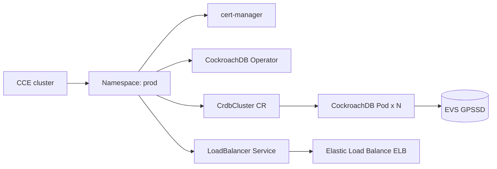

# data-integration-cockroachdb-cluster


> Deploy a highly available, TLS-encrypted **CockroachDB** distributed SQL database cluster on Huawei Cloud **CCE (Cloud Container Engine)** using Terraform.

## 1. Overview

### Introduction

This repository provides a reusable Huawei Cloud practice: Terraform automates the delivery of the CockroachDB Operator and database cluster on a CCE cluster (including namespace, Everest GPSSD storage class, cert-manager certificates, secure client, and ELB entry point). It is intended for teams that want to build a distributed database compatible with the PostgreSQL protocol on the Huawei Cloud container platform and obtain Infrastructure as Code (IaC) delivery capabilities.

---

## 2. Table of Contents

- [1. Overview](#1-overview)
- [2. Table of Contents](#2-table-of-contents)
- [3. Architecture Diagram](#3-architecture-diagram)
- [4. Highlights](#4-highlights)
- [5. Cloud Services Used](#5-cloud-services-used)
- [6. Prerequisites](#6-prerequisites)
- [7. Quick Start](#7-quick-start)
- [8. Step-by-Step Deployment](#8-step-by-step-deployment)
- [9. Usage / Verification](#9-usage--verification)
- [10. Cleanup](#10-cleanup)
- [11. Detailed Explanation](#11-detailed-explanation)
- [12. Dependencies](#12-dependencies)
- [13. FAQ / Troubleshooting](#13-faq--troubleshooting)
- [14. Contributing](#14-contributing)
- [15. License](#15-license)
- [16. Contact / Maintainers](#16-contact--maintainers)

---

## 3. Architecture Diagram



---

## 4. Highlights

- **Pure IaC delivery**: all resources are declared by Terraform, including templated rendering of K8s manifests.
- **Storage solution**: Everest CSI General Purpose SSD (GPSSD) provides persistent storage.
- **Ingress solution**: CCE Service annotations automatically create an ELB as the external access entry point.
- **Optional self-contained setup**: by default an existing CCE cluster is referenced; set `create_cce_cluster=true` to create the cluster + node pool + Everest add-on in one step.
- **Security and compliance**: credentials are provided only via environment variables, with no plaintext written to disk; runtime fields have `ignore_changes`.

---

## 5. Cloud Services Used

This practice uses the following Huawei Cloud services:

| Service | Purpose |
|---|---|
| CCE (Cloud Container Engine) | K8s cluster + node pool |
| Everest CSI (EVS GPSSD) | CockroachDB persistent storage |
| ELB (Elastic Load Balance) | Database external entry point |
| cert-manager (K8s component) | TLS certificate issuance |
| CockroachDB Operator | Database lifecycle management |

---

## 6. Prerequisites

- A Huawei Cloud account and target Region (default `cn-north-4`).
- Local tools: `terraform >= 1.5`, `kubectl`, and a machine that can access the target cluster.
- The target CCE cluster already exists (default) and has **cert-manager** pre-installed (via helm).
- Credentials are provided via environment variables: `HW_ACCESS_KEY` / `HW_SECRET_KEY` (add `HW_SECURITY_TOKEN` for temporary credentials).

---

## 7. Quick Start

```bash
cd infra
terraform init
terraform apply \
-var="region=cn-north-4" \
-var="cce_cluster_name=<你的CCE集群名>"
```

---

## 8. Step-by-Step Deployment

1. **Configure credentials** (do not write them into code or configuration files):
```bash
export HW_ACCESS_KEY="<HW_ACCESS_KEY>"
export HW_SECRET_KEY="<HW_SECRET_KEY>"
```
2. **Initialize**: `terraform init`
3. **Preview**: `terraform plan -var="cce_cluster_name=<集群名>"`
4. **Deploy**: `terraform apply -var="cce_cluster_name=<集群名>"`
5. **(Optional) Self-contained creation**: append `-var="create_cce_cluster=true" -var="vpc_id=<id>" -var="subnet_id=<id>" -var="node_password=<强密码>"`

---

## 9. Usage / Verification

### Usage and verification

```bash
# Check Pod status
kubectl --kubeconfig ~/.kube/config_cce_<集群名> -n prod get pods

# Check the ELB external IP
kubectl --kubeconfig ~/.kube/config_cce_<集群名> -n prod get svc cockroach-elb

# Connect to the database
kubectl --kubeconfig ~/.kube/config_cce_<集群名> -n prod exec -it cockroachdb-client-secure -- \
./cockroach sql --certs-dir=/cockroach/cockroach-certs --host=cockroachdb-public.prod
```

Expected: all 3 CockroachDB nodes are `Ready`, and SQL queries return normally.

> ⚠️ After deployment, follow these steps to verify that the business functionality works before considering the delivery complete.

---

## 10. Cleanup

```bash
terraform destroy # Option 2 also destroys CCE/ECS/EVS/ELB/EIP
```

> After destruction, check in the console via API whether ECS / EVS / ELB / EIP have orphan resources with `status=available` (especially EVS disks, since deleting an ECS does not necessarily delete its disks).

---

## 11. Detailed Explanation

- Architecture and components: `docs/architecture.md`
- Deployment guide: `docs/deployment-guide.md`

---

## 12. Dependencies

- [CockroachDB](https://www.cockroachlabs.com/) and its Kubernetes Operator.
- [cert-manager](https://cert-manager.io/) for certificate management.
- Huawei Cloud CCE / Everest CSI / ELB services.

---

## 13. FAQ / Troubleshooting

### FAQ

- **Certificate resource creation fails**: cert-manager is not installed on the target CCE cluster; run `helm install cert-manager` first.
- **Pods cannot pull images**: by default `cockroachdb/cockroach` is pulled from Docker Hub, so nodes need public network egress; for production, synchronize the image to SWR and replace the image address.
- **locality error**: if Pods cannot access the `169.254.169.254` metadata service, set `enable_locality=false`.
- **ELB domain name**: this practice does not automatically register DNS; manually configure an A record pointing to the ELB IP in the DNS service.

---

## 14. Contributing

Issues and PRs are welcome for feedback and improvement suggestions.

---

## 15. License

This practice uses the **MIT No Attribution** license (Copyright Huawei Cloud); see `LICENSE` in the repository root.

---

## 16. Contact / Maintainers
| Item | Content |
|---|---|
| **Creator** | [dgc-git](https://github.com/dgc-git) |
| **Maintainer** | [dgc-git](https://github.com/dgc-git) |
| **Contact** | GitHub Issues / PR (see [Section 14](#14-contributing)) |
