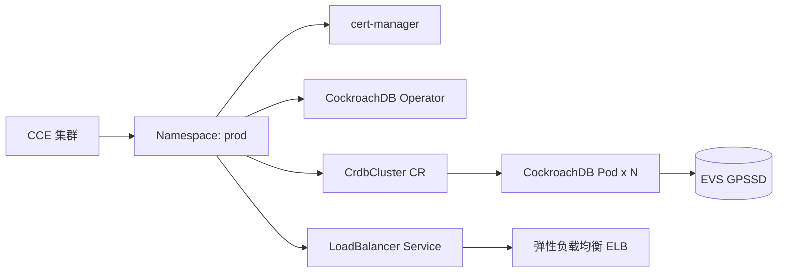

# data-integration-cockroachdb-cluster · CockroachDB on CCE（Terraform 一键部署）


> 基于 Terraform 在华为云 **CCE（云容器引擎）** 上部署一个高可用、TLS 加密的 **CockroachDB** 分布式 SQL 数据库集群。

## 1. 简介 / Overview

### 简介


本仓库提供一套可复用的华为云最佳实践：通过 Terraform 在 CCE 集群上自动化交付 CockroachDB Operator 与数据库集群（含命名空间、Everest GPSSD 存储类、cert-manager 证书、安全客户端与 ELB 入口）。适用于希望在华为云容器平台上自建兼容 PostgreSQL 协议的分布式数据库、并获得基础设施即代码（IaC）交付能力的团队。

---

## 2. 目录

- [1. 简介 / Overview](#1-简介--overview)
- [2. 目录](#2-目录)
- [3. 架构图](#3-架构图)
- [4. 方案亮点](#4-方案亮点)
- [5. 涉及云服务](#5-涉及云服务)
- [6. 前置条件](#6-前置条件)
- [7. 快速开始](#7-快速开始)
- [8. 分步部署](#8-分步部署)
- [9. 使用方法 / 验证](#9-使用方法--验证)
- [10. 清理资源](#10-清理资源)
- [11. 详细说明](#11-详细说明)
- [12. 依赖](#12-依赖)
- [13. FAQ / 故障排除](#13-faq--故障排除)
- [14. 贡献指南](#14-贡献指南)
- [15. 许可证](#15-许可证)
- [16. 联系方式 / 维护者](#16-联系方式--维护者)

---

## 3. 架构图



---

## 4. 方案亮点

- **纯 IaC 交付**：全部资源由 Terraform 声明，含 K8s 清单模板化渲染。
- **存储方案**：Everest CSI 通用型 SSD（GPSSD）提供持久化存储。
- **入口方案**：CCE Service 注解自动创建 ELB 作为对外访问入口。
- **可选自包含**：默认引用已有 CCE 集群；设 `create_cce_cluster=true` 可一键拉起集群 + 节点池 + Everest 插件。
- **安全合规**：凭据仅经环境变量提供，无明文落盘；运行期字段已 `ignore_changes`。

---

## 5. 涉及云服务

本实践使用以下华为云服务：

| 服务 | 用途 |
|---|---|
| CCE（云容器引擎） | K8s 集群 + 节点池 |
| Everest CSI（EVS GPSSD） | CockroachDB 持久化存储 |
| ELB（弹性负载均衡） | 数据库对外入口 |
| cert-manager（K8s 组件） | TLS 证书签发 |
| CockroachDB Operator | 数据库生命周期管理 |

---

## 6. 前置条件

- 华为云账号，目标 Region（默认 `cn-north-4`）。
- 本地工具：`terraform >= 1.5`、`kubectl`、可访问目标集群的机器。
- 目标 CCE 集群已存在（默认），且已预装 **cert-manager**（helm 安装）。
- 凭据通过环境变量提供：`HW_ACCESS_KEY` / `HW_SECRET_KEY`（临时凭证加 `HW_SECURITY_TOKEN`）。

---

## 7. 快速开始

```bash
cd infra
terraform init
terraform apply \
-var="region=cn-north-4" \
-var="cce_cluster_name=<你的CCE集群名>"
```

---

## 8. 分步部署

1. **配置凭据**（请勿写入代码或配置文件）：
```bash
export HW_ACCESS_KEY="<HW_ACCESS_KEY>"
export HW_SECRET_KEY="<HW_SECRET_KEY>"
```
2. **初始化**：`terraform init`
3. **预览**：`terraform plan -var="cce_cluster_name=<集群名>"`
4. **部署**：`terraform apply -var="cce_cluster_name=<集群名>"`
5. **（可选）自包含创建**：追加 `-var="create_cce_cluster=true" -var="vpc_id=<id>" -var="subnet_id=<id>" -var="node_password=<强密码>"`

---

## 9. 使用方法 / 验证

### 使用方法与验证


```bash
# 查看 Pod 状态
kubectl --kubeconfig ~/.kube/config_cce_<集群名> -n prod get pods

# 查看 ELB 外部 IP
kubectl --kubeconfig ~/.kube/config_cce_<集群名> -n prod get svc cockroach-elb

# 连接数据库
kubectl --kubeconfig ~/.kube/config_cce_<集群名> -n prod exec -it cockroachdb-client-secure -- \
./cockroach sql --certs-dir=/cockroach/cockroach-certs --host=cockroachdb-public.prod
```

期望：3 个 CockroachDB 节点均 `Ready`，SQL 查询正常返回。

> ⚠️ 部署完成后请按本节步骤自行验证，确认业务功能可用，方可视为交付完成。

---

## 10. 清理资源

```bash
terraform destroy # 方式二会一并销毁 CCE/ECS/EVS/ELB/EIP
```

> 销毁后请到控制台 API 直查 ECS / EVS / ELB / EIP 是否有 `status=available` 孤儿资源（尤其 EVS 云硬盘，ECS 删除不必然连带删盘）。

---

## 11. 详细说明

- 架构与组件：`docs/architecture.md`
- 部署指导：`docs/deployment-guide.md`

---

## 12. 依赖

- [CockroachDB](https://www.cockroachlabs.com/) 及其 Kubernetes Operator。
- [cert-manager](https://cert-manager.io/) 用于证书管理。
- 华为云 CCE / Everest CSI / ELB 服务。

---

## 13. FAQ / 故障排除

### FAQ


- **证书资源创建失败**：目标 CCE 集群未安装 cert-manager，请先 `helm install cert-manager`。
- **Pod 无法拉取镜像**：默认从 Docker Hub 拉取 `cockroachdb/cockroach`，节点需公网出口；生产建议同步至 SWR 后替换镜像地址。
- **locality 报错**：若 Pod 无法访问 `169.254.169.254` 元数据，设 `enable_locality=false`。
- **ELB 域名**：本实践不自动注册 DNS，需在云解析手动配置 A 记录指向 ELB IP。

---

## 14. 贡献指南

欢迎通过 Issue / PR 反馈问题与改进建议。

---

## 15. 许可证

本实践采用 **MIT No Attribution** 许可证（Copyright Huawei Cloud），详见仓库根目录 `LICENSE`。

---

## 16. 联系方式 / 维护者
| 项 | 内容 |
|---|---|
| **创建者** | [dgc-git](https://github.com/dgc-git) |
| **维护者** | [dgc-git](https://github.com/dgc-git) |
| **联系方式** | GitHub Issues / PR（见[第 14 节](#14-贡献指南)） |
