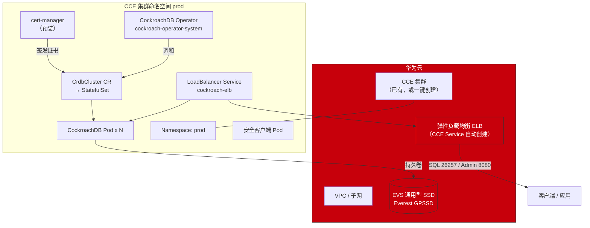

# 在 CCE 上部署 CockroachDB 集群

> 一份基于 Terraform + Huawei Cloud 的 CockroachDB on CCE 最佳实践。通过 Kubernetes Operator 在云容器引擎（CCE）上交付一个高可用、TLS 加密的分布式 SQL 数据库集群。

## 1. 架构总览

本实践使用 Terraform 在**已有**的 CCE 集群上交付 CockroachDB 所需的全部 Kubernetes 资源；数据库实例由 CockroachDB Operator 在集群内自愈管理。存储由华为云 Everest CSI 提供（EVS 通用型 SSD），对外访问由 CCE 自动创建的弹性负载均衡（ELB）承接。

## 2. 组件说明

| 组件 | 说明 |
|---|---|
| CCE 集群 | 云容器引擎，承载全部工作负载。默认引用已有集群；可设 `create_cce_cluster=true` 自动创建 |
| cert-manager | 第三方证书管理，为 CockroachDB 签发自签 CA 与节点/客户端证书（须预装） |
| CockroachDB Operator | 官方 Operator，监听 `CrdbCluster` 自定义资源并调和出 StatefulSet |
| everest-gpssd StorageClass | 基于 Everest CSI（`everest-csi-provisioner`）的 EVS 通用型 SSD（GPSSD）存储类，供 PVC 动态供给 |
| CockroachDB Pod | 由 StatefulSet 管理的数据库实例，每个 Pod 绑定一块 EVS 云硬盘 |
| 安全客户端 Pod | 用于执行 `cockroach sql` 管理命令的临时客户端 |
| LoadBalancer Service | 通过 CCE 注解自动创建 ELB，对外暴露 SQL（26257）与管理 UI（8080） |

## 3. 存储设计

使用华为云 Everest CSI 提供的自定义 StorageClass `everest-gpssd`：

- **provisioner**：`everest-csi-provisioner`（Everest 为 CCE 内置容器存储插件）
- **磁盘类型**：`everest.io/disk-volume-type = GPSSD`（通用型 SSD，IOPS 随容量自动伸缩）
- **绑定模式**：`WaitForFirstConsumer`（延迟绑定，配合多可用区调度）

## 4. 网络与访问

- 数据库 Pod 间通过 StatefulSet 域名互访，TLS 双向认证由 cert-manager 证书保障。
- 对外访问由 `cockroach-elb` Service 触发 CCE 自动创建**独享型 ELB（performance）**：
- 默认**公网** ELB（绑定 EIP），对外提供公网访问；
- 如需**私网**，将 `infra/modules/crdb/manifest/elb.yaml` 中 `autocreate` 的 `"type":"public"` 改为 `"type":"inner"` 并去掉带宽/EIP 字段。
- DNS：本实践不自动注册域名，需在**云解析（DNS）**手动将业务域名 A 记录指向 ELB 公网 IP。

## 5. 多可用区（可选）

`database.yaml` 中的 `--locality` 参数从节点元数据读取可用区，使 CockroachDB 可按 AZ 放置副本。该能力受变量 `enable_locality` 控制（默认开启），要求 Pod 能访问华为云元数据服务 `169.254.169.254`。若集群网络限制元数据访问，设 `enable_locality=false`，数据库仍可正常运行（仅失去 AZ 级副本放置优化）。
